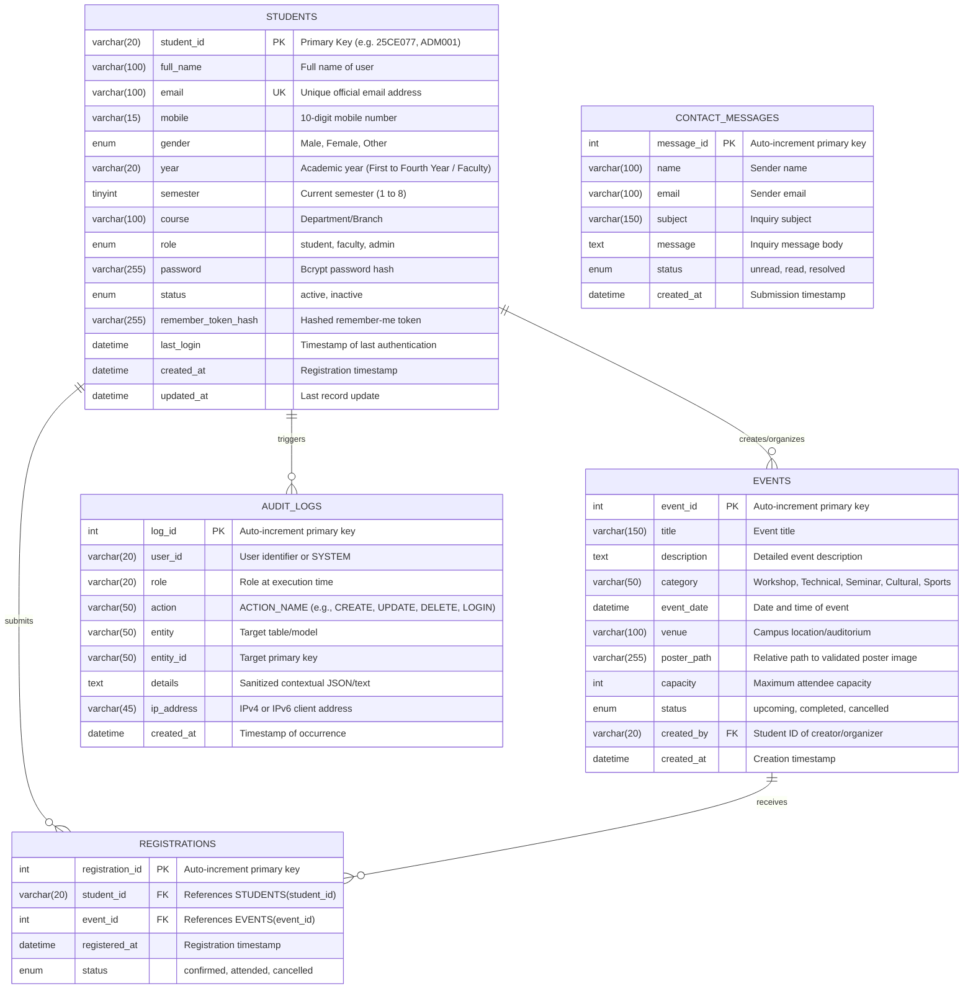

# StudentHub Portal — Entity-Relationship (ER) Model & Schema Specification
**Course:** ITUE203 — Web Development Frameworks  
**Practical 8:** Database Schema, ER Model, and PDO Connectivity  
**Student:** Dwij Patel (Student ID: 25CE077)  
**Institution:** CSPIT, CHARUSAT — B.Tech Computer Engineering  

---

## 1. Database Architecture Overview

The `studenthub` database is designed according to Third Normal Form (3NF) principles, eliminating data redundancy, transitive dependencies, and update anomalies. It comprises five core entities:

1. **`students`**: User identity, academic profiles, role-based authorization (`student`, `faculty`, `admin`), and bcrypt hashed credentials.
2. **`events`**: Campus technical hackathons, workshops, cultural festivals, and seminars with poster metadata, venue, and capacity quotas.
3. **`registrations`**: Relational junction table mapping student participation in events with a composite unique constraint preventing duplicate signups.
4. **`audit_logs`**: Immutable security log tracking all administrative, CRUD, and access events.
5. **`contact_messages`**: Public inquiries submitted via the helpdesk form.

---

## 2. Visual Entity-Relationship Diagram (Mermaid)

---

## 3. Relational Constraints & Integrity Rules

1. **Referential Integrity**:
   - `registrations.student_id` $\rightarrow$ `students.student_id` with `ON DELETE CASCADE ON UPDATE CASCADE`.
   - `registrations.event_id` $\rightarrow$ `events.event_id` with `ON DELETE CASCADE ON UPDATE CASCADE`.
2. **Duplicate Prevention**:
   - `uk_student_email` on `students.email` enforces unique email addresses globally.
   - `uk_student_event` composite unique key on `(student_id, event_id)` prevents a student from registering twice for the same event.
3. **Indexing Strategy**:
   - Primary Keys: B-Tree clustered index on `student_id`, `event_id`, `registration_id`, `log_id`, `message_id`.
   - Foreign Keys & Filters: Secondary non-clustered indexes on `role`, `course`, `category`, `event_date`, and `created_at` for high-throughput pagination and live search queries.
